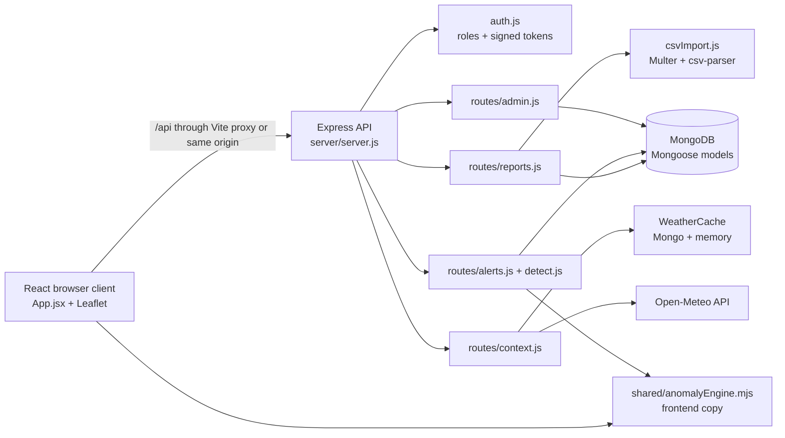
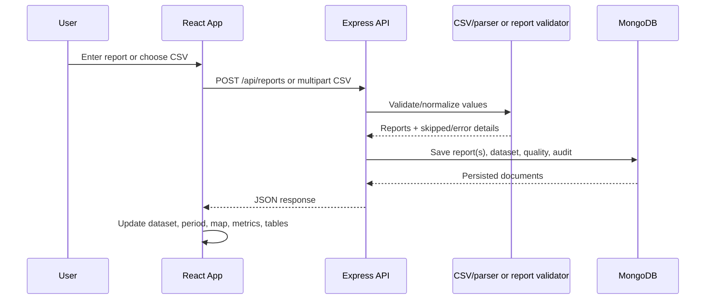
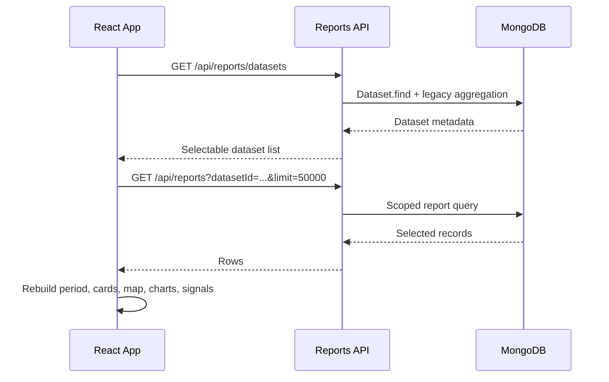

# OneHealth Dashboard — Complete Project Documentation

**Documentation status:** Based on the source currently present in this repository. Claims are marked as **Implemented**, **Partially implemented**, **Not found**, or **Recommendation** where that distinction matters.

## A. Project overview

### What the project does

OneHealth is a React and Express dashboard for viewing human-health, animal-health, and environmental reports in one operational view. It presents reports on an interactive map, summarizes activity by sector and location, calculates early-warning signals, supports CSV ingestion, records manual reports, and gives authorized users tools for alert validation, field-response tracking, user administration, audit review, and data-quality review.

## Enhancement update (2026-10-28)

- The default `datasetId=all` scope combines every ready persisted dataset, preserves each report's dataset/source provenance, and keeps browser-only CSV uploads local to that browser.
- CSV imports now persist uploader and synthetic-data metadata, calculate row fingerprints, skip duplicate records within an upload, and expose rejected/skipped counts.
- Environment measurements are retained as climate context and are excluded from disease-volume baselines; the detector does not infer causality from climate alone.
- Alert lifecycle operations support `new`, `acknowledged`, `investigating`, `resolved`, and `dismissed`, with actor/timestamp/note history and compatibility for legacy validation labels.
- Filtered CSV and dependency-free PDF exports are available at `GET /api/reports/export.csv` and `GET /api/reports/export.pdf`; both require `reports:read` and include source/dataset fields.
- Admins can remove a persisted dataset with `DELETE /api/reports/datasets/:datasetId`; viewers receive 403 for this and all other write operations through backend permission middleware.
- The map includes date range, sector, disease, location, severity, and minimum-volume filters and only maps records with valid coordinates or known location coordinates.

Known limitations: PDF export is a compact text report rather than a chart-rich publication; forecast modeling is not enabled, so alerts are observed anomaly signals only. MongoDB remains required for global persistence, and browser-only uploads are intentionally not shared across users.

The repository identifies the product as **One Health Dashboard** and describes it as an Impact Hackathon Track 05 project. The implementation is a working web application, but several values used for the demonstration are intentionally sample or heuristic data.

### Problem addressed

Health, livestock, climate, and movement information is often separated by sector. This application gives an analyst one place to inspect reports, compare recent activity with a baseline, and investigate locations that may require attention. It is an early-warning and operational-support tool; it does not diagnose disease or prove an outbreak.

### Target users

- Viewers who need read-only dashboard and alert access.
- Analysts who can add reports, import CSV files, validate alerts, and update field response status.
- Administrators who can do the analyst actions plus manage users, roles, audit records, and quality review.

### Implemented features

- Dashboard with metric cards, date-period handling, map markers, heat layer, movement corridors, filters, charts, and leading signals.
- CSV preview/import with schema aliases, row validation, provenance, quality scoring, and dataset-level identity.
- Persistent MongoDB reports and manual reports.
- Role-based signed tokens and salted password hashing.
- Alert detection using rules plus a deterministic isolation-forest-style/robust-distance ensemble.
- Alert explainability, manual validation, and response status updates.
- Optional live weather context from Open-Meteo with in-memory and MongoDB caching.
- Reports table with sector/location filters.
- Admin user management, audit trail, quality summary, source mix, and records-to-review tables.
- Browser-only CSV fallback when the backend/database is unavailable.

### Supported use cases

1. Seed a local MongoDB database and demonstrate a 30-day synthetic operational dataset.
2. Upload a compatible disease, climate, or livestock CSV and inspect its records.
3. Filter a location or sector and inspect the underlying rows.
4. Investigate an early-warning card and record an analyst decision.
5. Review data completeness and provenance before using a report operationally.

### Explicit boundaries

- **Implemented:** anomaly scoring and operational workflow.
- **Not implemented:** a trained disease-diagnosis model, disease confirmation, laboratory integration, or a learned model-training pipeline.
- **Partially implemented:** external weather is live when available, but the UI has demo climate defaults and fallback values.
- **Partially implemented:** uploaded CSVs are validated against a flexible generic schema; the parser does not provide a separate typed adapter for every possible external dataset.

## B. Technology stack

| Technology | Version in configuration | Purpose | Location | Relevance |
|---|---|---|---|---|
| JavaScript / Node.js | Node.js 20.19+ required by README; CommonJS server and ESM client/shared modules | Application runtime | `server/`, `client/`, `shared/` | Runs the API, frontend tooling, tests, and shared analytics |
| React | `^19.2.0` | Component-based UI | `client/src/App.jsx`, `client/src/main.jsx` | Holds page state and renders the dashboard |
| React DOM | `^19.2.0` | Browser rendering | `client/src/main.jsx` | Mounts `<App />` into `#root` |
| Vite | `^7.1.9` | Frontend dev server and production bundler | `client/vite.config.js` | Serves port 5173 and proxies `/api` to port 5000 |
| Tailwind CSS | `^3.4.17` | Utility styling | `client/src/App.jsx`, `client/src/styles.css` | Provides layout and utility classes |
| Leaflet | `^1.9.4` | Interactive map | `client/src/App.jsx` | Renders map tiles, markers, heat visualization, and popups |
| Express | `^5.0.0` (lockfile resolves a 5.x release) | HTTP API and static-file server | `server/server.js`, `server/routes/` | Hosts authentication, reports, alerts, admin, weather, and built frontend |
| Mongoose | `^8.0.0` | MongoDB ODM | `server/models/`, server routes | Defines schemas, indexes, queries, and persistence |
| MongoDB | URI supplied by `MONGO_URI`/`MONGODB_URI` | Persistent database | Server configuration | Stores users, reports, datasets, validations, audit logs, and weather cache |
| `csv-parser` | `^3.2.1` | Streaming CSV parsing | `server/csvImport.js` | Normalizes headers and reads uploaded rows |
| Multer | `^2.4.0` | Multipart file upload | `server/routes/reports.js` | Accepts a CSV in memory with a 100 MB limit |
| `dotenv` | `^16.0.0` | Environment loading | `server/server.js`, `server/seed.js` | Loads `server/.env` for the backend |
| `cors` | `^2.8.5` | Cross-origin policy | `server/server.js` | Restricts browser API origins when configured |
| `helmet` | `^8.3.0` | Security headers | `server/server.js` | Adds common HTTP security headers; CSP is disabled in this app |
| Node `crypto` | Built-in | Password hashing, HMAC token signing, dataset hash | `server/models/User.js`, `server/auth.js`, `server/datasetIdentity.js` | Avoids storing raw passwords and gives uploads stable content IDs |
| Node test runner | Built-in `node:test` | Backend/unit tests | `server/test/` | Tests parsing, authentication, quality, analytics, dataset identity, and anomaly logic |
| Playwright | `^1.64.0` | Screenshot workflow | `docs/screenshot-capture.spec.js` | Captures documented demo screenshots |
| Open-Meteo | External HTTP API, no package | Current weather context | `server/routes/context.js` | Supplies current temperature/rainfall and derived anomaly values |
| Esri Leaflet tiles | External tile service URL in client map | Basemap | `client/src/App.jsx` | Provides the dark map background used by the Leaflet map |

Dependencies listed in `package.json` are distinguished from actual use above. No Python, TensorFlow, PyTorch, database migration package, or model-training dependency was found.

## C. Project architecture

The application has three logical layers:

1. **Client:** React state and components in `client/src/App.jsx`; Vite builds it to `client/dist`.
2. **API:** Express in `server/server.js`, with route modules for reports, alerts, weather context, and admin functions.
3. **Persistence and shared logic:** MongoDB through Mongoose models; `shared/anomalyEngine.mjs` and `shared/reportAnalytics.mjs` are reusable analytics modules.

In production-style single-service mode, Express serves `client/dist` and the same process exposes `/api`. In development, Vite serves the client on port 5173 and proxies `/api` to the Express server on port 5000.



### Important design decisions

- The browser starts with `DEMO_REPORTS`, then replaces them with API data when authenticated and a dataset is available. If the API is unavailable it can remain in demo/browser mode.
- Report-shaped objects are normalized for the UI using `decorateUiReport`; backend fields such as `sector`, `disease`, and `cases` become compact UI fields `sec`, `dis`, and `n`.
- The frontend and backend alert paths use the shared anomaly engine, reducing drift between the alert page and API results.
- CSV dataset IDs are SHA-256 hashes of upload bytes. Identical bytes identify the same dataset; unrelated bytes receive different IDs.
- MongoDB readiness is checked before protected data routes. Authentication has a separate fallback path for explicitly configured demo users when MongoDB is unavailable.

## D. Folder and file structure

```text
oneHealth/
├── client/
│   ├── index.html
│   ├── package.json
│   ├── vite.config.js
│   ├── tailwind.config.js
│   └── src/
│       ├── main.jsx
│       ├── App.jsx
│       └── styles.css
├── server/
│   ├── server.js
│   ├── auth.js
│   ├── csvImport.js
│   ├── datasetIdentity.js
│   ├── reportQuality.js
│   ├── detect.js
│   ├── seed.js
│   ├── models/
│   ├── routes/
│   └── test/
├── shared/
│   ├── anomalyEngine.mjs
│   └── reportAnalytics.mjs
├── data/sample-one-health.csv
├── docs/
│   ├── DEPLOYMENT.md
│   ├── DEMO.md
│   ├── HACKATHON_CHECKLIST.md
│   ├── SUBMISSION.md
│   └── screenshots/
├── package.json
└── README.md
```

### Key files

| File | Responsibility and important symbols |
|---|---|
| `client/src/App.jsx` | Main React application. Contains demo data, CSV browser parser, login/signup UI, header/navigation, dashboard, map, charts, reports page, alerts page, pipeline page, admin page, dataset selector, API loading, upload handling, and alert actions. |
| `client/src/main.jsx` | Imports Leaflet CSS and application styles, then renders `App` under `React.StrictMode`. |
| `client/src/styles.css` | Tailwind entry point, CSS variables, responsive layout, map styling, login styling, dark-mode overrides, and reusable visual classes. |
| `client/vite.config.js` | Vite React plugin, port 5173, and `/api` proxy to `http://localhost:5000`. |
| `server/server.js` | Loads `.env`, configures Express, Helmet, CORS, JSON limit, rate limiter, database startup, auth endpoints, readiness guard, route mounting, static frontend serving, and error fallback. |
| `server/auth.js` | Role permissions, configured/demo users, database authentication, PBKDF2 verification, HMAC-signed token creation/verification, token revocation, audit writing, and `requirePermission`. |
| `server/csvImport.js` | Header aliases, BOM-safe normalization, numeric/date parsing, sector detection, required-header validation, row conversion, and skip/error reporting. |
| `server/datasetIdentity.js` | `datasetIdForBuffer` and `legacyDatasetId`. |
| `server/reportQuality.js` | Quality flags, source confidence, quality score calculation, and provenance attachment through `withReportQuality`. |
| `server/detect.js` | Loads `shared/anomalyEngine.mjs` and calls `computeAlerts` using default climate and corridor context. |
| `server/routes/reports.js` | Dataset listing, report listing, CSV preview/import, and manual report creation. |
| `server/routes/alerts.js` | Last-30-day alert detection, manual validation, response status, model profile, and dashboard stats. |
| `server/routes/context.js` | Weather point parsing, Open-Meteo fetch, cache lookup/write, and fallback readings. |
| `server/routes/admin.js` | Admin user CRUD, audit listing, and report quality summary. |
| `server/models/*.js` | Mongoose schemas for `Report`, `Dataset`, `User`, `AuditLog`, `AlertValidation`, and `WeatherCache`. |
| `shared/anomalyEngine.mjs` | Shared alert rules, city buckets, baseline statistics, deterministic isolation-forest-style score, robust-distance score, validation evidence, risk, and confidence. |
| `shared/reportAnalytics.mjs` | Date filtering, sector case aggregation, dashboard metrics, climate observation count, and disease case aggregation. |
| `server/seed.js` | Generates and replaces report demo data and upserts configured role users. |
| `docs/DEPLOYMENT.md` | Single-service/split deployment commands and environment requirements. |
| `docs/DEMO.md` | Demonstration and screenshot workflow. |

## E. Page-by-page website documentation

The client uses a single React entry point rather than a React Router package. Navigation is application state (`page`) in `App`; the header buttons select page values. The URL is not used as the page router.

### Login and signup view

- **Route/state:** initial unauthenticated view; `App` renders `LoginPage`.
- **Purpose:** authenticate a user or create a viewer account.
- **Inputs:** username/email and password. Password visibility can be toggled.
- **Actions:** login calls `POST /api/auth/login`; signup calls `POST /api/auth/signup`.
- **Validation:** signup requires a username/email accepted by the server and a password of at least eight characters. Login errors are mapped to a safe user-facing message.
- **Success:** login stores `{ token, user }` in local storage under `onehealth-auth`, then the app loads datasets and reports. Signup shows a success message and returns to login flow.
- **Failure/loading:** submit buttons are disabled while the request is running; server errors are shown in the login error panel. A missing database produces a 503 message for signup rather than a false success.

### Dashboard

- **Navigation value:** `dashboard`.
- **Purpose:** summarize the selected reports and show locations needing investigation.
- **UI:** `Top`, period controls, metric cards, `MapPanel`, early-warning cards, `LineChart`, and `LeadingSignals`.
- **Data:** `reports` state, filtered through `periodizeReports`; alert state is generated from the analysis period unless an uploaded dataset suppresses current-alert inference.
- **Interactions:** switch reporting period, sector/location filters, toggle heatmap and livestock corridors, choose map severity/minimum cases, select a map location, inspect popup details, and upload CSV.
- **Empty/loading:** API reports replace demo data when available; no matching reports results in empty-state messaging in the relevant cards/table.

### Reports

- **Navigation value:** `reports`.
- **Purpose:** enter a report and inspect stored/loaded rows.
- **UI:** form fields for disease, sector, location, cases, date/context, and animal-specific details; sector and location filters; report table.
- **API:** `POST /api/reports` when live; browser state is used in demo mode. The page receives its rows from the parent `reports` state.
- **Validation:** server validates disease/sector/location, cases 1–500 for manual entry, mortality, coordinates, and date. Animal fields are shown only for the animal sector.
- **Failure/empty:** save errors are toasted; no matching rows shows “No reports match these filters.”

### Alerts / Early warnings

- **Navigation value:** `alerts`.
- **Purpose:** show locations that crossed the anomaly engine thresholds and explain why.
- **UI:** `AlertItem`, validation controls, field response controls, city selector, and `DetectionChart`.
- **API:** server alert context is loaded from `GET /api/alerts`; analyst/admin actions use `POST /api/alerts/:location/validate` and `/respond`.
- **Business rule:** a city is considered for an alert from the recent seven days and a 23-day baseline. Rule and ML-style evidence are displayed separately from manual validation.
- **Failure/empty:** “No unusual increases this week.” is displayed when no alerts are available. Alerts are signals for investigation, not confirmed outbreaks.

### Data pipeline

- **Navigation value:** `pipeline`.
- **Purpose:** make collection, cleaning, merging, detection, validation, climate context, quality, and provenance visible.
- **UI:** stage counts, source table, climate table, corridor table, model profile, report-quality indicators, and provenance table.
- **Data:** computed from the current `reports`, `alerts`, weather context, and `ML_MODEL` profile.
- **Interactions:** climate rows can be expanded with the page-local `climateExpanded` state.
- **Limit:** several corridor values and initial climate context are fixed demo values, documented in README and code.

### Admin

- **Navigation value:** `admin`; available only to `users:manage` users.
- **Purpose:** manage roles and inspect operational data quality.
- **API:** `GET/POST/PATCH /api/admin/users`, `GET /api/admin/audit`, and `GET /api/admin/quality`.
- **UI:** user/role table, create-user form, audit trail, quality summary, flag table, source mix, and records-to-review table. Long audit/review lists have Show more/Show less controls.
- **Validation:** usernames, passwords, roles, active state, and update permissions are checked server-side.
- **Failure:** loading errors show a toast; non-admin users see a login/permission message.

### Common navigation and notifications

`Header` renders Dashboard, Reports, Alerts, Data pipeline, and Admin controls. It exposes database/demo status, login/logout, responsive mobile navigation, and alert count. `showToast` displays short transient notifications. Local storage preserves authentication and selected dataset ID; no server-side session cookie is used.

## F. Feature-by-feature workflows

### Startup and database readiness

1. `server/server.js` loads `server/.env` using `dotenv`.
2. It starts Express immediately and calls `connectDatabase()`.
3. Mongoose connects using `MONGO_URI` or `MONGODB_URI` with the configured selection timeout.
4. `User.init()` ensures the user schema/index initialization has completed.
5. Configured users are upserted unless `BOOTSTRAP_AUTH_USERS=false`.
6. Protected non-auth API calls receive 503 while MongoDB is not connected.
7. `/api/health` reports `database`, `databaseConfigured`, and numeric `databaseState`.

### Authentication

1. The browser posts credentials to `/api/auth/login`.
2. With MongoDB connected, `authenticateUser` finds an active user and verifies a PBKDF2-SHA256 password hash using 210,000 iterations.
3. Without MongoDB, explicitly configured fallback users can authenticate.
4. `createToken` produces a base64url payload plus HMAC-SHA256 signature and eight-hour expiry.
5. The client stores the token locally and sends it as `Authorization: Bearer ...`.
6. `readAuthUser` verifies the signature/expiry and maps the role to permissions.
7. Logout removes the client token and adds it to the process-local revoked-token set.

### Manual report creation

1. User fills the Reports form.
2. `ReportsPage.saveReport` posts JSON to `/api/reports` when live.
3. `requirePermission('reports:write')` permits analyst/admin only.
4. The route validates fields and calls `withReportQuality` with manual provenance.
5. Mongoose creates a `Report` document and an audit event.
6. The client reloads/updates visible reports and shows a toast.

### CSV preview and persistent import

1. User selects a `.csv` file through `CsvUploadButton`.
2. In live mode, the client first posts multipart data to `/api/reports/import-csv/preview`.
3. `multer` stores the file in memory and rejects files above 100 MB or non-CSV files.
4. `parseReportCsvBuffer` normalizes headers, parses rows, validates required fields, and reports imported/skipped rows.
5. The browser displays an import confirmation with filename, row count, skipped count, and date range.
6. Confirmation sends the file to `/api/reports/import-csv`.
7. The server computes a SHA-256 content dataset ID, upserts a `Dataset` record, deletes only reports with that dataset ID, adds provenance and quality scores, and inserts valid reports.
8. Dataset status becomes `ready`, audit data is written, and the client selects the new dataset and reloads all dashboard views.
9. If the API/database is unavailable, the client parses the file with its browser parser and uses `csv_browser` in memory.

### Multi-dataset selection

1. After authentication, `loadDatasets` calls `GET /api/reports/datasets`.
2. The selector lists ready, legacy, and imported datasets with row counts.
3. The selected ID is stored in `onehealth-dataset-id`.
4. `loadReports` sends `datasetId` and `limit=50000` to the report API.
5. Changing the dataset clears selected location/alert validation state and reloads reports, period, map, charts, and metrics.
6. Identical upload bytes have the same ID and are replaced idempotently; different bytes coexist.

### Alert calculation and validation

1. Backend `GET /api/alerts` loads reports from the last 30 calendar days.
2. `detect.js` calls `computeAlerts` from the shared engine.
3. City buckets contain 30 daily values, with seven recent days and 23 baseline days.
4. Rule evidence uses minimum recent volume 8, ratio 1.8, and z-score 2. ML-style evidence uses score 0.66 and a ratio guard.
5. Feature rows include recent total, ratio, positive z-score, active sectors, environment values, and corridor load.
6. Alerts include risk, confidence, drivers, validation checks, model version, severity, and suggested next step.
7. Manual validation/response is persisted by location in `AlertValidation` and merged into future API responses.

### Weather context

1. The client builds up to 12 encoded `City:lat:lon` points from visible reports.
2. `/api/context/weather` checks memory and MongoDB cache.
3. Cache misses call Open-Meteo with current temperature, rain, and precipitation.
4. The server derives a rough temperature anomaly and rainfall anomaly, stores the result for three hours, and returns readings.
5. Network/API failure returns a safe fallback reading and does not fail the dashboard.

## G. Backend and API reference

All protected routes require an `Authorization: Bearer <token>` token unless explicitly noted. The authorization middleware checks permissions listed in `server/auth.js`.

| Method | Endpoint | Auth | Purpose / request | Response and errors | Implementing file |
|---|---|---|---|---|---|
| GET | `/api/health` | Public | No body | `{ ok, database, databaseConfigured, databaseState }` | `server/server.js` |
| POST | `/api/auth/login` | Public | JSON `username`, `password` | `{ user, token }`; 401 invalid credentials; 503 when no DB and no configured fallback | `server/server.js`, `auth.js` |
| POST | `/api/auth/signup` | Public | JSON `username` or `email`, `password` | 201 viewer user; 400 validation; 409 duplicate; 503 DB/schema unavailable; 500 persistence failure | `server/server.js` |
| POST | `/api/auth/logout` | Public | Bearer token optional | 204; revokes token in current process | `server/server.js`, `auth.js` |
| GET | `/api/auth/me` | Bearer | No body | Current public user; 401 if missing/invalid | `server/server.js` |
| GET | `/api/ml/model` | `reports:read` | No body | `ML_MODEL` profile; note that `routes/alerts.js` also declares this route after server-level route | `server/server.js`, `routes/alerts.js` |
| GET | `/api/reports/datasets` | `reports:read` | No body | Dataset metadata including ID, file name, status, row counts, and date range; includes legacy grouped imports | `routes/reports.js` |
| GET | `/api/reports` | `reports:read` | Query `datasetId`, `sector`, `location`, `limit` (1–50,000 in current route) | Newest-first report documents; 400 invalid sector/limit | `routes/reports.js` |
| POST | `/api/reports/import-csv/preview` | `reports:write` | Multipart field `file`; CSV ≤100 MB | File name, row counts, date range, five-row sample; 400 parser/validation errors; 413 oversized file | `routes/reports.js`, `csvImport.js` |
| POST | `/api/reports/import-csv` | `reports:write` | Multipart field `file`; CSV ≤100 MB | 201 inserted/skipped counts, dataset ID, status, date range; 400 import/parser errors; 413 oversized | `routes/reports.js` |
| POST | `/api/reports` | `reports:write` | JSON `disease`, `sector`, `location`, `cases`; optional coordinates, date, animal metadata | 201 saved report; 400 invalid fields | `routes/reports.js` |
| GET | `/api/alerts` | `alerts:read` | No body | Current 30-day alert list plus manual validation | `routes/alerts.js`, `detect.js` |
| POST | `/api/alerts/:location/validate` | `alerts:validate` | JSON `status` (`validated`, `review`, `dismissed`), optional `note` | Saved manual validation; 400 invalid location/status | `routes/alerts.js` |
| POST | `/api/alerts/:location/respond` | `alerts:validate` | JSON `responseStatus` (`new`, `investigating`, `sample_collected`, `contained`, `resolved`), optional note | Saved response status; 400 invalid value | `routes/alerts.js` |
| GET | `/api/dashboard/stats` | `reports:read` | No body | Seven-day and previous-seven-day sector totals plus alert count | `routes/alerts.js` |
| GET | `/api/context/weather` | `reports:read` | Query `points=City:lat:lon\|City:lat:lon`, max 12 | `source`, `readings`, and `env` anomaly map; 400 missing/invalid points | `routes/context.js` |
| GET | `/api/admin/users` | `users:manage` | No body | Public-safe users with role/active/permissions/timestamps | `routes/admin.js` |
| POST | `/api/admin/users` | `users:manage` | JSON username, password, role | 201 public-safe user; 400 invalid; 409 duplicate | `routes/admin.js` |
| PATCH | `/api/admin/users/:username` | `users:manage` | JSON role, active, optional password | Updated public-safe user; 400 invalid; 404 missing | `routes/admin.js` |
| GET | `/api/admin/audit` | `users:manage` | Query action, actor, limit (1–200) | Newest audit events | `routes/admin.js` |
| GET | `/api/admin/quality` | `users:manage` | Query limit | Quality totals, source mix, flags, and up to 50 review samples from selected query | `routes/admin.js` |

The global `/api` middleware returns 503 for non-auth API routes while MongoDB is disconnected. All unhandled server errors are logged and returned as the generic `Internal server error` message.

## H. Database documentation

### Technology and initialization

MongoDB is accessed through Mongoose. There are no migration files or migration framework in the repository. Mongoose schema initialization and index creation happen as models are used; `User.init()` is explicitly awaited during startup. `server/seed.js` is the available demo initialization script and deletes all `Report` documents before inserting generated sample reports.

### Collections/models

#### `Report`

Fields include `datasetId`, `disease`, `sector` (`human|animal|environment|unknown`), `location`, optional latitude/longitude, `cases`, animal metadata (`species`, `symptoms`, `mortality`, `deaths`, vaccination, confirmation, farm, block), provenance (`sourceType`, `sourceName`, uploader/time), quality (`dataQualityScore`, `qualityFlags`), `date`, `year`, `weekNumber`, `state`, `district`, temperature, precipitation, source dataset/URL, and `isSynthetic`.

Required fields are disease, sector, and location. Cases default to 1 and are constrained to 1–1,000,000,000. Coordinates have geographic bounds. `date` is indexed; dataset ID, source type, and quality score are indexed.

#### `Dataset`

`datasetId` is required, unique, and indexed. `contentHash` is required, unique, and indexed. Other fields are file name, source dataset, status (`importing|ready|failed`), import time, row/imported/skipped/rejected counts, date minimum/maximum, normalized headers, error text, and timestamps.

#### `User`

Unique lower-case username, role (`viewer|analyst|admin`), password hash/salt, active flag, last login, and timestamps. Raw passwords are not stored.

#### `AuditLog`

Action, actor, role, resource metadata, arbitrary details, IP/user-agent, and timestamps. Action and actor are indexed through the schema fields where configured.

#### `AlertValidation`

Unique location, manual status (`validated|review|dismissed`), field response status, note, actor, role, timestamps, and response update time.

#### `WeatherCache`

Unique location, coordinates, current temperature/rainfall, derived anomalies, source, fetch time, expiry, and timestamps. Location and expiry are indexed.

### Data lifecycle

- Create: manual reports, CSV inserts, seed records, users, validations, audit events, weather cache.
- Read: filtered report lists, dataset list, admin summaries, alert computation, and map/dashboard state.
- Update: user role/status/password, alert validation/response, dataset import status, weather cache.
- Delete: CSV replacement deletes only matching `datasetId`; seed deletes all reports. There is no user-facing report deletion route.

### Backup and persistence considerations

MongoDB is the persistence layer, but no automated backup, retention, export, or migration script was found. Production operators must provide MongoDB backup/restore separately. In-memory weather cache and revoked tokens are lost on restart. Uploaded files are held in memory and are not stored as files.

## I. Authentication and security

- **Password storage — Implemented:** PBKDF2-SHA256 with random salt and 210,000 iterations in `User`.
- **Token — Implemented:** signed HMAC-SHA256 bearer token with eight-hour expiry. This is a custom token format, not a third-party JWT library.
- **Roles — Implemented:** viewer can read reports/alerts; analyst adds report writing and alert validation; admin adds user management.
- **Authorization — Implemented:** `requirePermission` protects routes; public user objects contain only username, role, and permissions.
- **Transport/configuration — Partially implemented:** CORS is configurable, Helmet is enabled, and API rate limiting is per process/IP. HTTPS termination is not configured in this repository and must be supplied by deployment infrastructure.
- **Input limits — Implemented:** JSON body limit 100 KB; CSV upload limit 100 MB; report text and query values are bounded; coordinates and numeric fields are checked.
- **Upload safety — Implemented:** multipart file filter accepts CSV MIME type or `.csv` extension; parser validates headers and skips malformed rows. CSV is held in memory, so deployment memory limits remain important.
- **Secrets — Required:** `AUTH_SECRET`, database URI, and non-demo passwords must be supplied through environment variables. No secret values are included here.
- **Audit — Implemented:** login, report, import, user, and alert operations write audit events when MongoDB is connected.
- **Risks/limitations:** fallback demo credentials exist by default in code when environment variables are absent; the custom token revocation set is process-local; rate-limit state is process-local; CSP is explicitly disabled; no CSRF mechanism was found because the API uses bearer tokens rather than cookies.

## J. AI, machine learning, and algorithms

### Shared anomaly engine

`shared/anomalyEngine.mjs` is an algorithmic early-warning engine, not a trained disease model.

**Inputs:** report location, sector, disease, cases, date/day, optional environment values, and corridor load.

**Preprocessing:** reports are bucketed by city into 30 daily slots. Cases are summed by city, sector, and disease. The recent period is seven days; the baseline is the previous 23 days.

**Rule logic:**

- `minRecent = 8`
- `minRatio = 1.8`
- `minZ = 2`
- `minMlScore = 0.66`

For the baseline, the engine calculates a mean and standard deviation. A rule alert requires recent volume, recent-to-baseline ratio, and z-score thresholds. A second path can raise an alert using an ML-style score with a minimum recent volume and ratio guard.

**ML-style score:** `isolationForestScores` builds deterministic random isolation paths over feature vectors. `robustFeatureRows` scales features using median and interquartile spread. `robustDistanceScores` calculates normalized Euclidean distance. The final score combines forest score (72%) and robust-distance score (28%). This is implemented algorithmic scoring, not trained inference.

**Features:** recent reports, recent/baseline ratio, positive z-score, active sectors, absolute temperature anomaly, rainfall anomaly, and corridor load.

**Outputs:** alert location, disease, recent and baseline values, ratio, z-score, risk, confidence, severity, drivers, ML score, model profile, evidence checks, method, and recommended next step.

### Model profile and claims

`ML_MODEL` labels the profile `oh-ensemble-2026.10`, describes it as a calibrated isolation-forest plus robust-distance ensemble, and contains calibration numbers (precision 0.82, recall 0.76, F1 0.79) for “synthetic outbreak backtesting.” Those metrics are configuration metadata in the code; no training code, model artifact, evaluation dataset, or independent reproducibility script was found. They should not be presented as production clinical accuracy.

### Other algorithms

- `reportQuality.js`: weighted penalties for missing coordinates, provenance, stale reports, and animal metadata; source confidence contributes to a 0–100 quality score.
- `reportAnalytics.mjs`: date-window filtering, sector case totals, climate observation counts, and disease totals.
- `server/csvImport.js`: alias matching, numeric cleanup, date parsing, sector heuristics, and row rejection.
- `context.js`: rough latitude-based temperature baseline and rainfall-derived anomaly.

No trained neural network, disease classifier, feature-training pipeline, model file, or model download was found.

## K. Data flow and business logic

### Report flow



### Dataset selection flow



### Metric rules

- Human cases are summed from `cases`/`n` only for rows explicitly classified as human.
- Animal reports are row counts when animal rows exist; otherwise analytics returns unavailable (`null`) rather than fabricating zero.
- Climate observations count rows containing a numeric temperature or precipitation value. They are observations, not environmental incidents.
- Disease ranking sums cases by disease and tracks sector subtotals.
- `filterReportsByPeriod` uses record dates and excludes future/older rows for a selected window; an `all` period preserves legacy rows with day-only values.
- Historical datasets should be interpreted using their actual dates; the UI’s period/date-range logic is separate from current-week alert logic.

### Date and CSV rules

The server parser supports normalized aliases such as `date`, `report_date`, `observation_date`, `cases`, `count`, `latitude`, `longitude`, `district`, `state`, climate fields, and animal metadata. It supports BOM-prefixed headers through header normalization, numeric strings, Excel serial dates, year-only fallback, common day/month or month/day numeric forms, missing optional values, and safe row skipping.

Sector detection prioritizes explicit sector values, then evidence in disease/species/symptoms, then source-dataset keywords. It returns `unknown` when evidence is insufficient; it does not force every imported row into human, animal, or environment.

## L. Environment setup and local execution

### Prerequisites

- Node.js 20.19 or newer, per `README.md`.
- MongoDB for persistent/live mode. A local MongoDB instance or Atlas URI may be used.
- A browser for the dashboard.

### Install

```bash
cd oneHealth/client
npm install

cd ../server
npm install
```

The repository root has a `screenshots` script, but the client and server have the main application scripts.

### Environment

Create `server/.env` from the project’s existing `.env.example` without committing it. Required/important variables are:

```dotenv
MONGO_URI=mongodb://127.0.0.1:27017/onehealth
MONGO_SERVER_SELECTION_TIMEOUT_MS=10000
PORT=5000
CORS_ORIGIN=http://localhost:5173,http://localhost:5000
RATE_LIMIT_MAX=300
AUTH_SECRET=<long-random-secret>
ADMIN_PASSWORD=<admin-password>
ANALYST_PASSWORD=<analyst-password>
VIEWER_PASSWORD=<viewer-password>
BOOTSTRAP_AUTH_USERS=true
```

`MONGODB_URI` is accepted as an alias. `AUTH_USERS` can define users as JSON or semicolon-separated `username:password:role` entries. `ADMIN_TOKEN` is a legacy optional token accepted as `x-admin-token`. Never put real values in documentation or source control.

### Database initialization

There is no migration command. For demo data:

```bash
cd server
npm run seed
```

Warning: `seed.js` deletes all `Report` documents before inserting generated data. It also upserts the three configured role users.

### Start backend and frontend

Single-service mode after a client build:

```bash
cd client
npm run build

cd ../server
npm start
```

Open `http://localhost:5000`.

Frontend development with backend running separately:

```bash
cd server
npm run dev

cd ../client
npm run dev
```

Open `http://localhost:5173`; Vite proxies `/api` to port 5000.

### Tests and build

```bash
cd server
npm test

cd ../client
npm run build
```

Root-level screenshot capture:

```bash
cd ..
npm install
npm run screenshots
```

## M. Testing and code quality

The server uses Node’s built-in `node:test` runner. Test files cover:

- `auth.test.js`: token permissions, bad credentials, role restrictions, password hashing.
- `csvImport.test.js`: compatible rows, BOM/EpiClim-style data, missing headers, large case values, missing deaths.
- `datasetIdentity.test.js`: stable/different content IDs and legacy IDs.
- `reportAnalytics.test.mjs`: period filtering, sector aggregation, human case totals, climate observation counts, unavailable animal data.
- `anomalyEngine.test.mjs` and `detect.test.js`: shared shapes, deterministic scoring, alert thresholds, stable baseline, future/old rows.
- `reportQuality.test.js`: animal quality flags, provenance, and dataset identity.

The client has no separate unit-test script in `client/package.json`. The available production check is `npm run build`; the root Playwright script is for screenshot capture rather than a full browser regression suite.

### Verified during this documentation task

The source/configuration review verified the commands and test definitions. A fresh test/build run was not performed as part of generating this document, so this file does not claim a new test pass. Run the commands above before release and record the output in deployment notes.

### Coverage gaps

- No integration test starts Express against a real MongoDB instance.
- No automated two-dataset end-to-end browser test was found.
- No test verifies every API error response or live Open-Meteo behavior.
- No migration/backup test exists.
- No client unit-test suite exists.

## N. Deployment and production configuration

`docs/DEPLOYMENT.md` documents two supported shapes:

### Single service

Build client and install server dependencies, then start `server`. Express serves `client/dist` and exposes the API. Configure MongoDB, `AUTH_SECRET`, production users/passwords, and CORS.

### Split deployment

Build/deploy the Vite client separately and run the Express API separately. Set `CORS_ORIGIN` to the deployed frontend URL. The frontend’s development proxy is not a production API proxy; a deployed client must point at the correct API origin through the hosting setup or same-origin arrangement.

### Production requirements and risks

- MongoDB must be network-accessible from the backend.
- `AUTH_SECRET` and non-demo passwords must be set.
- Use HTTPS at the reverse proxy/hosting layer.
- Do not use `seed.js` against production data because it deletes reports.
- Configure persistent MongoDB backups; the app does not do this.
- Size backend memory for in-memory CSV uploads up to 100 MB.
- Use a shared rate-limit/revocation/session strategy if horizontally scaling; the current maps are process-local.
- Verify `/api/health`, protected API access, dataset import, and logout after deployment.

No provider-specific deployment manifest, Dockerfile, CI pipeline, or cloud infrastructure configuration was found in the inspected files.

## O. Limitations and known issues

1. **Demo fallback data:** the client starts with `DEMO_REPORTS` and can use browser-only demo CSV state when the backend is unavailable. This is useful for demonstrations but must be clearly distinguished from MongoDB data.
2. **Demo corridors:** corridor routes in `CORRIDORS` are fixed values in `App.jsx`; they are not imported from a live movement system.
3. **Demo climate defaults:** `DEFAULT_ENV` and client `ENV` values are used before live weather data arrives and can remain as fallback.
4. **Heuristic sector classification:** unknown rows remain unknown; keyword classification can still be imperfect and should be reviewed.
5. **Alert recency:** backend alerts use the current last 30 days. Historical CSV datasets may therefore produce no current alerts, which is correct but not a historical-outbreak analysis.
6. **ML terminology:** the isolation-forest-style and robust-distance computations are implemented algorithms, but no trained artifact or training/evaluation pipeline is present.
7. **Calibration metadata:** the profile contains synthetic-backtesting metrics, but their provenance cannot be independently verified from this repository.
8. **Database migrations:** no migration/versioning system is present; schema changes rely on Mongoose and deployment discipline.
9. **Process-local security state:** token revocation and rate limiting reset on restart and are not shared across instances.
10. **Weather availability:** Open-Meteo is optional; timeout/error fallback is expected and can return null current values.
11. **No report deletion UI:** reports can be created and imported, but there is no general user-facing deletion endpoint.
12. **Quality summary limit:** admin quality aggregation reads only the requested limited set (default 500), so its summary can be a sample rather than a full-collection total for large datasets.
13. **Potential route duplication:** `/api/ml/model` is declared in both `server.js` and `routes/alerts.js`; the server-level route handles requests first.
14. **No automated full production verification:** the repository has unit tests and a build, but no real-database smoke test in the checked-in test suite.

## P. Future improvements (recommendations)

- Add a migration/versioning process and explicit indexes for high-volume report queries.
- Add dataset import transactions or staging collections so a failed replacement cannot leave a partially imported dataset.
- Add a full-dataset quality aggregation path instead of a limited sample for admin statistics.
- Add real browser tests for upload, dataset switching, historical date ranges, and repeated uploads.
- Replace process-local rate limiting and token revocation with shared infrastructure in a multi-instance deployment.
- Make API origin a documented build/runtime configuration for split deployments.
- Replace demo corridors and climate defaults with versioned, provenance-tracked data sources.
- Separate trained-model code and artifacts from rule-based anomaly scoring, and publish reproducible evaluation data/results.
- Add backup/restore documentation and automated database health alerts.
- Add accessibility tests, keyboard coverage, and explicit loading states for every dashboard panel.

## Q. Glossary

| Term | Meaning |
|---|---|
| One Health | A view that considers human, animal, and environmental health together. |
| Report | One stored observation/event row with a disease or signal, location, date, and case count. |
| Sector | `human`, `animal`, `environment`, or `unknown` classification. |
| Dataset ID | SHA-256 hash of an uploaded CSV’s bytes, used to scope and replace that dataset only. |
| Provenance | Information about where a record came from and who/imported it. |
| Data quality score | A 0–100 heuristic score based on completeness, source confidence, and warning flags. |
| Baseline | The prior 23 daily values used to compare with the most recent seven days. |
| Ratio | Recent activity divided by the baseline’s usual level. |
| Z-score | Standard-deviation-based measure of how far recent activity is above the baseline. |
| Alert | A generated signal that evidence crossed configured thresholds; not a confirmed outbreak. |
| Manual validation | An analyst/admin decision that marks an alert validated, review, or dismissed. |
| Corridor load | Fixed or configured movement volume associated with routes leaving a city. |
| Browser/demo mode | In-memory data path used when the backend is unavailable or a browser CSV is not persisted. |
| PBKDF2 | A password-key derivation method used here with a salt and repeated hashing. |
| Bearer token | A signed token sent in the HTTP Authorization header to identify the user. |

## R. Demonstration and viva preparation

### One-minute explanation

“OneHealth is a full-stack early-warning dashboard for human, animal, and environmental reports. The React client presents a map, metrics, charts, data pipeline, and alerts. The Express API stores reports and users in MongoDB, supports validated CSV imports and dataset selection, and protects operations with role permissions. A shared anomaly engine compares the recent seven days with a 23-day baseline and combines rule evidence with a deterministic ML-style anomaly score. Analysts can validate alerts and record field responses, while administrators can manage users and inspect provenance and quality. The system is designed to prioritize investigation; it does not claim to diagnose disease.”

### Three-minute demonstration flow

1. Start MongoDB, run seed once, start the server, and open the dashboard.
2. Log in as viewer to show read-only dashboard, map, filters, metrics, and alert explanation.
3. Upload `data/sample-one-health.csv` as analyst/admin and show preview, date range, imported rows, map, and pipeline.
4. Change sector/location/date or dataset selection and show that the displayed rows and metrics refresh.
5. Open an alert, inspect baseline/threshold/drivers, and mark it for review or validation as an analyst.
6. Update field response to `investigating`, `sample_collected`, `contained`, or `resolved`.
7. Open Reports to create an animal report with species/farm/block metadata.
8. Log in as admin and show role management, audit trail, data-quality flags, source mix, and records to review.
9. Explain which values are live MongoDB records, which are Open-Meteo context, and which are documented demonstration defaults.

### Defensible implementation highlights / USPs

1. One screen joins three health sectors rather than showing only disease rows.
2. Dataset IDs isolate independent CSV uploads and make identical-byte retry replacement deterministic.
3. CSV parsing preserves provenance, climate fields, animal metadata, and skipped-row information.
4. The frontend and backend share the same alert engine module.
5. Alerts include evidence checks and drivers rather than only a red score.
6. Alert validation and operational response are persisted per location.
7. Report quality is explicit and includes actionable flags.
8. Role permissions distinguish viewing, analysis, and administration.
9. The application can demonstrate in browser mode while still supporting MongoDB persistence.
10. External weather failures degrade to a safe fallback rather than breaking the dashboard.

### Likely viva questions and accurate answers

1. **What is the main purpose?** — To combine reports and context across human, animal, and environmental health for investigation and early warning.
2. **Which frontend framework is used?** — React 19 with Vite and Tailwind CSS.
3. **Which backend framework is used?** — Express 5 on Node.js.
4. **Where are persistent records stored?** — MongoDB through Mongoose.
5. **Is the app multi-page?** — It is a single React application with page state, not React Router URLs.
6. **How is a CSV identified?** — By SHA-256 hash of the upload bytes.
7. **Can two different datasets coexist?** — Yes; different content hashes produce different dataset IDs and report queries accept `datasetId`.
8. **What happens on a repeated identical upload?** — The same dataset ID is selected and its scoped reports are replaced, avoiding duplicate retry inserts.
9. **How are passwords stored?** — PBKDF2-SHA256 hashes with random salts; raw passwords are not stored.
10. **What does the viewer role do?** — Read reports and alerts.
11. **What can an analyst do?** — Viewer access plus report writes and alert validation/response.
12. **What can an admin do?** — Analyst access plus user management and admin quality/audit views.
13. **Is the ML model trained in this repository?** — No. The code implements deterministic isolation-forest-style and robust-distance scoring; no training artifact/pipeline is present.
14. **What does an alert mean?** — A statistical/algorithmic signal requiring investigation, not a confirmed outbreak.
15. **How is the baseline calculated?** — Previous 23 daily buckets are compared to the latest seven days.
16. **What external service is used?** — Open-Meteo for optional current weather context.
17. **What happens if weather fails?** — The route returns fallback readings and the client retains demo/default context.
18. **How is a report’s quality score produced?** — Missing context flags receive penalties and source confidence contributes to a clamped 0–100 score.
19. **Are migrations present?** — No migration framework or migration files were found; Mongoose initialization and the seed script are used.
20. **What does the seed script do?** — It deletes all `Report` documents, inserts generated 30-day demo reports, and upserts role users.
21. **How is signup protected when MongoDB is down?** — Signup waits for database readiness and returns 503; it does not claim account creation.
22. **Why is there a browser CSV mode?** — To support demonstrations when the backend is unavailable; those rows are not persistent MongoDB records.
23. **What are the main production risks?** — Demo defaults, process-local rate/revocation state, absent migrations/backups, in-memory uploads, and unverified model calibration metadata.
24. **How would you improve production scale?** — Shared rate limiting/session state, import staging/transactions, indexed query planning, backups, browser integration tests, and a verified model/data pipeline.

## Verification notes

This document was created from the inspected repository files, including:

- root/client/server `package.json` files and lockfiles;
- `README.md`, `docs/DEPLOYMENT.md`, `docs/DEMO.md`, and supporting docs;
- `client/src/App.jsx`, `main.jsx`, `styles.css`, and Vite/Tailwind configuration;
- all server routes, startup/auth/import/quality/detection modules;
- all Mongoose models;
- shared analytics/anomaly modules;
- server tests and sample data.

No credentials, database URI values, tokens, private user information, or raw secrets are included. The documentation intentionally calls out features that are heuristic, demo-backed, optional, or not verifiable from source.
